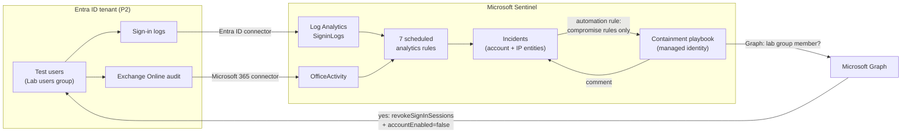

# Microsoft Sentinel identity attack detection and response

Seven KQL analytics rules cover password spray, MFA fatigue, risky sign-ins and suspicious mailbox rules. The ARM templates include a Logic App design for session revocation and account disabling. The verified results below cover the six original synthetic incidents.

## Architecture



## Detections

| Rule | Logic | ATT&CK | Severity | Auto-contain |
| --- | --- | --- | --- | --- |
| Password spray | One IP failing against 5+ accounts in 15 min (bad password, Smart Lockout, unknown user); High if the IP then signs in successfully | T1110.003 | Medium / High | No: only the IP is known |
| MFA push flooding | 5+ sign-ins in 15 min with a denied or ignored push | T1621 | Medium | No |
| MFA fatigue success | 3+ failed pushes, then a successful sign-in within 30 min | T1621, T1078.004 | High | Yes |
| New country | Successful sign-in from a country absent from the user's 7-day history | T1078.004 | Low | No: travel is common |
| Impossible travel | Consecutive sign-ins >500 km apart at >900 km/h | T1078.004 | Medium | Yes |
| Suspicious inbox rule | Forward/redirect, delete, or move to RSS/Archive/Conversation History (PowerShell, OWA and Outlook client rules) | T1114.003, T1564.008 | High | No. The mailbox entity provides a UPN, and live containment requires an Entra object ID. |
| High-risk sign-in | Successful sign-in rated high risk by Entra ID Protection | T1078.004 | High | Yes |

## Response playbook

The production automation rule targets MFA fatigue followed by successful sign-in, impossible travel, and high-risk successful sign-in. For each account in those incidents, the playbook:

1. Reads the account entity from the incident.
2. Requires an explicitly allowed Entra object ID and membership in the dedicated **Lab users** group before a live action. Keep both lists limited to unprivileged test accounts.
3. In dry-run mode (default) comments what it would do; with `dryRun=false` it calls
   `revokeSignInSessions`, sets `accountEnabled=false`, and comments the result.

It authenticates with its own managed identity, using Microsoft Graph application
permissions (`deployment/Grant-PlaybookGraphPermissions.ps1`) and Microsoft Sentinel Responder
on the workspace. There are no secrets or stored credentials.

## Results

| Evidence | Status |
| --- | --- |
| Synthetic deployment: 6 original rules each created a Sentinel incident (Nov 23, 2026) | Done, see [incident-report.md](incident-report.md) |
| All seven updated queries run in Azure Monitor Logs against the expanded fixture | Verified, see [incident-report.md](incident-report.md) |
| Live Entra and Exchange connector validation | Pending, see [validation guide](docs/SIMULATION.md) |
| Playbook containing a real account (sessions revoked, account disabled) | Pending |
| End-to-end run of the updated containment template | Pending |

## Deploy

```sh
mkdir -p build
# Generate a synthetic detection template (test queries expire after 1 hour)
python3 deployment/build_template.py synthetic build/identity-lab-synthetic.json

# Real SigninLogs / OfficeActivity
python3 deployment/build_template.py production build/identity-lab-production.json
```

Deploy the JSON with **Deploy a custom template** into the resource group that holds the
Sentinel workspace. Set `workspaceName` and `location` explicitly. The production playbook also uses `labGroupId`, `allowedLabUserIds` (Entra object IDs), and `dryRun` (default `true`). Grant the managed identity Microsoft Graph permissions only in an isolated lab tenant, using its exact object ID and the tenant ID with `deployment/Grant-PlaybookGraphPermissions.ps1`. See the [validation guide](docs/SIMULATION.md).

To test a single query by hand, paste `tests/fixtures.kql` followed by one file from
`analytics/` into Sentinel → Logs.

| Query on the test data | Expected result |
| --- | --- |
| Password spray | 192.0.2.10, 5 accounts, `spray3` succeeded → High. 192.0.2.20 (one user, 4 typos) is not flagged |
| MFA push flooding | `mfa`, 5 failed pushes |
| MFA fatigue success | `fatigue` (3 denials, then approved). `slip` (1 denial) is not flagged |
| New country | `traveler`, GB |
| Impossible travel | `traveler`, US → GB |
| Suspicious inbox rule | `mail` (forward), `rss` (RSS Subscriptions), `client` (Outlook rule). `normal` is not flagged |
| High-risk sign-in | `risky` |

## Layout

```
analytics/    one KQL file per rule (first comment lines become the rule description)
tests/        inline test data for the queries; unit tests for the template builder
deployment/   build_template.py (ARM generator), Graph permission script
docs/         synthetic validation and lab connector checklist
incident-report.md   incident evidence and response decisions
```

## Tuning notes

- Thresholds are set for a small lab; raise the spray and push counts for a real tenant.
- Impossible travel ignores same-IP pairs; corporate VPN and mobile carrier egress still cause
  false positives, so check the IP owner before containing.
- The Outlook client branch of the inbox rule check matches text in the audit record; check
  it against your tenant's `OfficeActivity` data.
